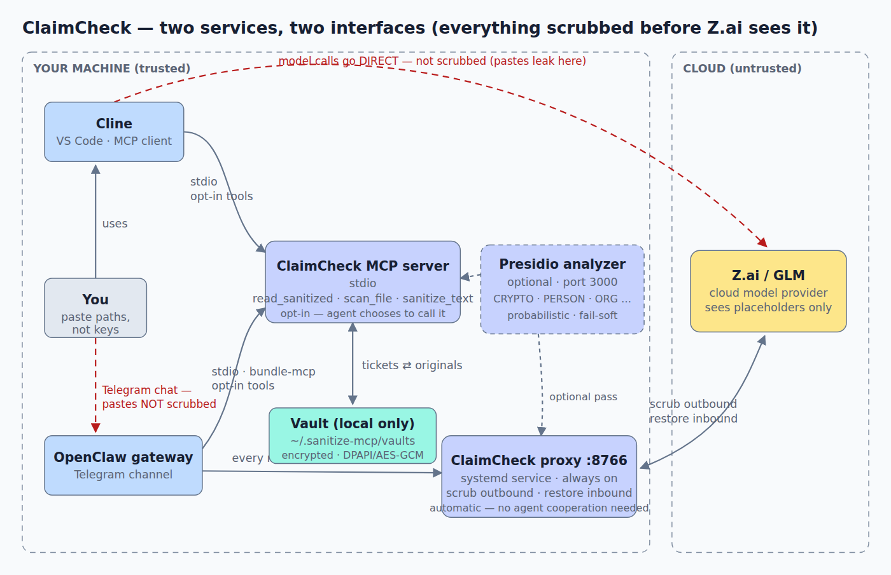

# ClaimCheck

**Check your PII at the door. Your LLM gets claim tickets.**

🌐 **[claimcheck.saasclaw.ai](https://claimcheck.saasclaw.ai)** — project site · [ClawHub listing](https://clawhub.ai/normandmickey/skills/claimcheck) · [Releases](https://github.com/saasclawai-org/ClaimCheck/releases)

ClaimCheck is a local-first pseudonymization gate for LLM workflows. One self-contained
binary, two modes:

- **MCP server** — for Cline, Cursor, or any MCP client: the model reads files *through it*
  and receives scrubbed content with stable placeholders
- **LLM proxy** — point any OpenAI-compatible client at it: every request is scrubbed on the
  wire, every response restored before your editor sees it

The model works on `[FEIN_1]`, `[SSN_2]`, `[CLIENT_3]`-style claim tickets. You reclaim the
real values on the way out. The provider processes structure — never plaintext identity.

## Why

AI coding assistants are an exfiltration surface. Files, logs, and pasted context flow into
provider clouds as part of normal operation — occasionally without consent (see Zhipu's ZCode
incident, September 2026). Vendor promises — zero retention, no training — don't change the
basic fact: **plaintext crossed the wire.**

ClaimCheck flips it: scrub locally, so plaintext never enters the prompt at all. The provider
processes pseudonyms; your machine holds the identity map.

This is pseudonymization, not redaction. Redaction is entity-blind and one-way — the model
sees holes and the data is gone. ClaimCheck's placeholders are stable, distinguishable
(`[FEIN_1]` ≠ `[FEIN_2]`, and `[FEIN_1]` appearing in four places *means* something), and
reversible through a local vault — so tasks like cross-referencing, deduplication, and
document editing come out identical to running on raw data.

## How it works

```
 your editor (real values)
         │   read_sanitized / chat requests
         ▼
   [ ClaimCheck ]  ── scrub: identifiers → [FEIN_1], [SSN_2] …  ──▶  LLM provider
         ▲                                                                 │
         └─────────── restore: tickets → real values  ◀────────────────────┘

   vault: placeholder ⇄ original — local only, never transmitted
```



*Rendered view of the two services and how Cline and OpenClaw connect — interactive HTML version in [`docs/architecture.html`](docs/architecture.html).*

## Mode 1 — MCP server (stdio)

For Cline, Cursor, Claude Desktop, or any MCP client. Adds three tools:

| Tool | Behavior |
|---|---|
| `read_sanitized(path)` | file content with PII replaced by tickets + findings summary |
| `scan_file(path)` | findings summary only (types, counts, line numbers) — no content |
| `sanitize_text(text)` | scrub arbitrary text, returns sanitized version + summary |

Point your client at the binary (stdio transport):

```json
{
  "mcpServers": {
    "claimcheck": {
      "command": "/path/to/ClaimCheck",
      "args": []
    }
  }
}
```

Then tell your agent the rule — for Cline, a `.clinerules` file in the repo:

```
Any file that may contain personal data must be read with the ClaimCheck
read_sanitized tool, never with read_file. Never echo raw identifiers into chat.
```

## Recommended: add ClaimCheck to your Cline rules

The tools work on demand out of the box. To make Cline reach for ClaimCheck
automatically, add these lines to your workspace `.clinerules` file (or
Cline Settings → Rules → Global Rules):

```
## PII safety (ClaimCheck)

- For ANY file that may contain client/employee data (FEIN, SSN, account
  numbers, credentials): use the claimcheck `read_sanitized` tool instead of
  `read_file`.
- Never paste raw FEIN/SSN/card values into chat, logs, or commits.
- Use claimcheck `sanitize_text` before quoting real data into code, tests,
  or docs.
```

## CLI for agents and scripts

The same binary doubles as a plain CLI — one line from any script or agent, no MCP
handshake needed:

```bash
# text from stdin or argument → JSON {summary, findings, sanitized}
echo "..." | ClaimCheck sanitize-text
ClaimCheck sanitize-text "some text"

# file → summary only, or with sanitized content
ClaimCheck sanitize-file path/to/file
ClaimCheck sanitize-file path/to/file --content
```

The JSON parses trivially (Python `json.loads`, Node `JSON.parse`), so agents can pipe it
through `jq`/`python` without speaking MCP. `.clinerules` and `llms-install.md` consumers
use the same verbs.

New here? [`examples/`](examples/) has a complete worked example — a four-secret sample
file (all values fake), the verified `sanitize-file` output, and a `run-example.ps1`
script that does the full scan → ticket → restore round-trip with a PASS/FAIL check.

## OpenClaw integration

[OpenClaw](https://docs.openclaw.ai) runs ClaimCheck as a first-class local MCP server
(self-hosted, stdio — nothing leaves the machine). Add to `openclaw.json`:

```json5
{
  mcp: {
    servers: {
      claimcheck: {
        command: "dotnet",
        args: ["<path>/bin/Release/net9.0/ClaimCheck.dll"],
        enabled: true,
        env: { SANITIZE_NER: "1" }   // optional — opt into the NER tier
      }
    }
  }
}
```

The three tools (`sanitize_text`, `read_sanitized`, `scan_file`) then project into every
OpenClaw session as native tools (`bundle-mcp`), and OpenClaw skills can call the CLI
verbs directly. Restart the gateway after editing the config.

## Mode 2 — LLM proxy (streamable HTTP / SSE)

A reverse proxy for OpenAI-compatible clients. Everything a request carries — file reads,
DB results, pasted logs, conversation history — is scrubbed at the wire, regardless of what
the model chose to read.

```bash
ClaimCheck --proxy --upstream https://api.example-provider.com/v1 --port 8766
```

On Windows, `install.ps1 -WithProxy` registers the proxy as a logon **tray app**
(`ClaimCheckTray.exe` — a green/red shield in the system tray; double-click for live
status). `ClaimCheck status` / `status --json` works on any OS: proxy state, request
and scrub counters, NER mode, vault size, MCP wiring.

The mapping vault lives on your machine and is **encrypted at rest** on Windows (DPAPI; optional
AES-GCM password mode everywhere via `SANITIZE_VAULT_PASSWORD`).
Point your client's base URL at `http://127.0.0.1:8766/v1` and keep your real API key in the
client — auth passes through untouched. Streaming (SSE) is supported, including placeholders
split across chunk boundaries.

### Why the proxy matters (enforcement vs opt-in)

The MCP tools sanitize only when the agent chooses to call them — every use is opt-in.
A pasted-by-mistake secret, or a prompt-injection trick that makes the agent exfiltrate
data, bypasses tools entirely. The proxy closes that gap: it sits between your client and
the model provider, so EVERY model-bound request — including everything already in the
conversation history — is scrubbed before the provider sees it. No agent cooperation
required; only placeholders cross the wire.

### OpenClaw example (verified live)

Run the proxy as a user service. Keep the provider path in `--upstream` (as below): the
proxy composes the client's request path onto it, and if the client's own base URL already
carries the same path prefix — OpenClaw builds differ on this — it is stripped once before
composing, so either client base-URL shape lands on the same upstream URL. (With a bare-
root upstream, only clients that send the full provider path work.)

    ClaimCheck --proxy --upstream https://api.z.ai/api/coding/paas/v4/ --port 8766

and point the provider at it in `openclaw.json`:

```json5
{
  models: {
    providers: {
      zai: { baseUrl: "http://127.0.0.1:8766/api/coding/paas/v4" }
    }
  }
}
```

Every OpenClaw model call now crosses the scrub — verified live against Z.ai chat
completions, streaming included, with placeholders restored on the response path.

**Troubleshooting (OpenClaw version differences):** builds construct provider URLs
differently — some append only `/chat/completions` to the configured base URL, newer ones
append the full provider path themselves. Mismatch symptom: model calls 404 with a doubled
or re-ordered path (e.g. `/v4/api/coding/paas/v4/...`). Fix: match the shapes — this proxy
strips a duplicated prefix automatically — and set `SANITIZE_PROXY_LOG=1` on the service
for one stderr line per request (method, path, upstream status, ms) to see exactly what
crosses the wire.

**Multiple instances (one per lane):** pass each a distinct `--vault /path/vault.json` —
vaults are per-instance namespaces, restorable only through the instance that scrubbed
them. Saves are atomic and locked (concurrent-safe); upstream connection failures return
a clean 502, never a stack-trace 500.

**Scrub coverage:** only `POST` requests ending in `chat/completions` are scrubbed and
restored — every other path (embeddings, image endpoints, native provider APIs like
Anthropic's `/v1/messages` or OpenAI's Responses API) is forwarded verbatim. Reach
providers through OpenAI-compatible surfaces. **[docs/PROXY.md](docs/PROXY.md)** has the
provider-by-provider upstream URLs (Z.ai, OpenAI, Claude's compat layer, OpenRouter,
local vLLM), a systemd template unit for running a multi-lane fleet, path-composition
rules, update ordering, and the reversal-probe verification.

**Optional detection backend:** `SANITIZE_PRESIDIO_URL=http://127.0.0.1:3000` points the
proxy at a live [Presidio](https://microsoft.github.io/presidio/) analyzer service for
multi-language NER and international entity formats (crypto wallets, country IDs, …).
Presidio findings are tier-separated — probabilistic, labeled by entity type, masked
through the same vault with stable placeholders and restore — and the pass is skipped
fail-soft when the service is down. Tune with `SANITIZE_PRESIDIO_SCORE` (default 0.4)
and `SANITIZE_PRESIDIO_ENTITIES` (comma-separated allowlist; `DATE_TIME`/`TIME` are
excluded by default — they flag benign prose).

**Honest limits:** the proxy covers the model-provider hop only — the chat surface
(Telegram, Discord, ...) still sees whatever was pasted before the proxy could act. And
model FALLBACK providers configured outside the proxy are not covered.

## What it catches

Built-in recognizers (regex + validators — deterministic, no ML, no downloads):

- Employer ID / FEIN (`XX-XXXXXXX`)
- SSN (with invalid-area guards)
- Email addresses
- US phone numbers
- Credit card numbers — keyword-anchored lines (`Card:`, `Visa`, `Mastercard`, …) masked
  regardless of checksum validity, plus generic Luhn-validated detection for bare PANs
  + CVV / expiry dates
- IBAN
- AWS access keys
- GitHub tokens
- `sk-` / `sk_` API keys
- Slack tokens
- JWTs
- Passwords & secrets behind `password` / `pwd` / `passwd` / `passphrase` / `secret` with `:` or `=` — JSON (`"password": "…"`), YAML, quoted or plain .env, prefixed keys (`DB_PASSWORD=…`, `client_secret=…`); value masked, label and syntax preserved
- PEM private-key blocks (BEGIN→END, whole block)
- Encoded dumps (base64/hex) — decoded and masked before matching
- Dates of birth, passport numbers, driver's licenses, bank routing numbers, IP addresses
- Street addresses (street + city + state + ZIP)
- Medical license numbers, insurance member IDs

Extend it with `.sanitize-patterns.json` in your project root — same contract, your domain:

```json
[{ "name": "MEMBER_ID", "regex": "\\bM[0-9]{8}\\b", "placeholder": "MEMBER" }]
```

## Tickets & the vault

Placeholders are stable per project: `[FEIN_1]` always maps back to the same value, so the
model can reason consistently across an entire session. The vault lives on your machine
(`~/.sanitize-mcp/vaults/`) and is never transmitted.

Restore locally whenever you need real values back:

```bash
ClaimCheck restore <file->        # or read from stdin with -
```

## NER tier — free-text names, orgs, locations (opt-in)

The regex tier can't see free-text names. ClaimCheck optionally runs a local English NER
model (quantized BERT ONNX, ~109 MB, downloaded once from HuggingFace) that catches
PERSON/ORG/LOC/MISC entities in prose and issues tickets for them:

```
Employer: Jane Doe, FEIN [FEIN_1]   →   Employer: [PERSON_1], FEIN [FEIN_1]
```

Enable with `SANITIZE_NER=1` in the environment of the ClaimCheck process. Tuning:
`SANITIZE_NER_THRESHOLD` (default 0.5), `SANITIZE_NER_MODEL` (any HuggingFace
token-classification ONNX repo). Model cache: `~/.claimcheck/models/`. Inference runs
locally (~1–3 s per call); subword pieces of one entity are merged into a single ticket
(the B-B quirk), and the config's label order is honored with a verified fallback.
Model licenses vary on HuggingFace — check the card of whichever model you point at.

Subword tokenization can split one name into adjacent tickets — those are snapped to
full-word boundaries and merged, so `Satya Nadella` becomes a single ticket (fixed in
v0.1.0; a regression invariant in `test_ner.py` guards it).

## Security model — the honest version

**Covered:** structured identifiers (FEIN, SSN, cards, IBAN, AWS/GitHub/Slack keys, API
keys, JWTs, connection-string passwords, PEM private-key blocks, base64/hex encoded
blobs) — the high-volume leak class. Free-text names, orgs and locations via the opt-in
NER tier. Everything runs locally; nothing phones home; the vault and the plaintext
never leave your machine.

**Not covered:** PDF/DOCX and other binary formats (refused, not scrubbed — text
extraction is roadmap); non-English text (the NER model is English-trained); other
jurisdictions' tax-ID formats (that's what pluggable recognizer packs are for — roadmap).

**Enforcement layers, strongest first:** the proxy mode scrubs everything on the wire
(regardless of agent behavior); the MCP tools scrub what the agent chooses to read (needs a
rules file like the one above). Use the proxy when the provider is a cloud you don't trust
with plaintext; the MCP mode is enough on its own for local models.

**Known scope:** chat-completions requests are scrubbed in proxy mode; other endpoints pass
through. Binary files are refused, not scrubbed.

## No warranty — read this before you rely on it

ClaimCheck is a best-effort sanitization tool, provided **AS IS** under the MIT license
(no warranty, no liability — see `LICENSE` and `DISCLAIMER.md`). In plain language:

- **No sanitizer catches 100%.** Recognition is pattern- and model-based; false negatives
  and false positives happen. Verify outputs before sharing anything high-stakes.
- **Not legal or compliance advice.** Using ClaimCheck does not make you GDPR-, HIPAA-,
  PCI- or otherwise compliant, and it is not a certified control. Your data, your
  obligations, your verification.
- **The NER tier is statistical** and English-trained — it will miss and mangle things.
- **The vault is stored unencrypted** on your machine (until the encryption tier ships).
  Anyone with access to your user profile can reverse the placeholders. Protect your
  machine accordingly.
- **Defense in depth:** use ClaimCheck as one layer, not your only layer.

## Build & test

Requires .NET 9.

```bash
dotnet build -c Release
python3 test_dotnet.py        # MCP tools: scrub fidelity, no-leak, vault, restore
python3 test_proxy.py         # proxy: scrub-on-wire, restore-on-response, SSE split handling
python3 test_proxy_paths.py   # proxy: upstream path composition (both client shapes)
python3 test_recognizers.py   # recognizer coverage incl. field-leak regressions
python3 test_ner.py           # NER tier regression
dotnet publish -c Release -f net9.0-windows -r win-x64 --self-contained true -p:PublishSingleFile=true -o publish/win-x64
dotnet publish -c Release -f net9.0 -r linux-x64 --self-contained true -p:PublishSingleFile=true -o publish/linux-x64
dotnet publish tray/ClaimCheckTray.csproj -c Release -f net9.0-windows -r win-x64 --self-contained true -p:PublishSingleFile=true -o publish/win-x64-tray
```

The `-f` flag is required — the project targets multiple frameworks and publish fails
without it (`NETSDK1129`).

Cutting a Windows release zip: use `tools/package-release.sh <version>` — it packages
ClaimCheck.exe **and** ClaimCheckTray.exe + INSTALL.txt and fails if any is missing.
The tray hosts the proxy in-process; a zip without the tray exe silently strands
Windows users on old versions (v0.7.4–v0.8.1 shipped that way).

Cross-compiles from Linux/macOS to Windows (and vice versa) — the publish output is a single
self-contained executable.

## Documentation

- [docs/PROXY.md](docs/PROXY.md) — proxy deployment: provider surfaces, multi-lane fleets, coverage rules, update ordering
- [docs/PLACEHOLDERS.md](docs/PLACEHOLDERS.md) — placeholder ticket semantics: vault scoping, stability guarantees, why the numbering is opaque
- [docs/COMPARISON.md](docs/COMPARISON.md) — ClaimCheck vs Presidio: the four-problems framing and the optional Presidio detection backend

## Roadmap

- [x] Encoded-output scrubbing — base64/hex dumps decoded and masked before matching
- [x] Fail-closed proxy posture (`SANITIZE_FAIL_CLOSED=0` to disable)
- [ ] Label-anchored heuristics (names after `Contact:`, `Owner:` …)
- [x] Local NER tier for free-text names/addresses (`SANITIZE_NER=1`, local ONNX model)
- [ ] Hashed-identifier columns (peppered HMAC) for database lookups
- [ ] Pluggable recognizer packs
- [x] Vault encryption at rest — DPAPI on Windows, AES-GCM password mode everywhere (`SANITIZE_VAULT_PASSWORD`)
- [ ] OCR pass for scanned documents

## License

[MIT](LICENSE) — Copyright (c) 2026 Norman Moore
